

<h1>Turki Altasan</h1>

<h3>Turning business data into clear decisions.</h3>

<strong>Data Analyst · Business Intelligence · Data Science</strong> Riyadh, Saudi Arabia

  
  
  

<a href="#about">About</a> · <a href="#experience">Experience</a> · <a href="#featured-project">Featured project</a> · <a href="#more-projects">More projects</a> · <a href="#toolkit">Toolkit</a> · <a href="#credentials">Credentials</a>

---

## The questions behind my dashboards

**How are we performing? Where are the gaps? What should we focus on next?**

I'm a Data Analyst with **2+ years of experience**, developing Power BI solutions across **Sales, Finance, and Procurement**. I work with management and sales teams to track performance, understand profitability, and identify growth opportunities.

My work connects data preparation, modeling, and visualization with the decisions people need to make: which customers to prioritize, where targets are slipping, and which products contribute to growth.

## Experience in numbers

| **210,000+** | **13% → ≤5%** | **13+** | **5** |
| :---: | :---: | :---: | :---: |
| Rows integrated and analyzed | Revenue share from unidentified customers | Sales representatives covered | Branches across Saudi Arabia |

- **Performance visibility:** Built connected Power BI dashboards with automated refresh, target tracking, remaining goals, and MoM, YoY, and YTD comparisons.
- **Data quality:** Collaborated with the sales team to reduce the share of revenue attributed to unidentified customers from 13% to 5% or less.
- **Sales effectiveness:** Developed 6+ performance metrics to highlight target achievement, customer engagement, and improvement areas.
- **Customer opportunities:** Analyzed purchasing patterns and product performance to support cross-selling, outreach, and purchasing decisions.

These figures describe my professional experience. The portfolio project figures below describe their respective datasets.

---

## Featured project · Business Intelligence Dashboard

**One reporting experience. A 360° view of sales performance.**

An integrated Power BI solution connecting executive KPIs with customer behavior, product profitability, regional performance, sales channels, and sales representative effectiveness.

**Business question:** Where is performance strong, where are we missing targets, and which customers, products, or teams deserve attention?

  
  
  

  <a href="https://github.com/TurkiAltassan/TurkiAltassan/blob/main/For-sales-14.png">
    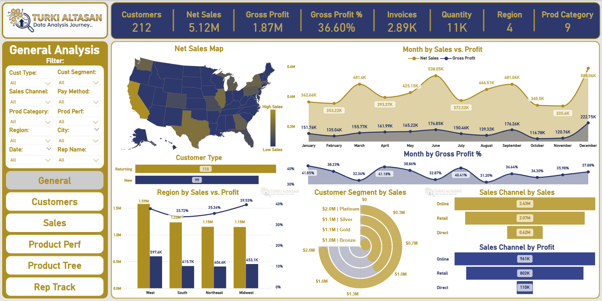
  </a>

Click the preview to inspect the full-size image. Expand the gallery below to explore the other report pages.

| Net Sales | Gross Profit | Gross Margin | Customers | Coverage |
| :---: | :---: | :---: | :---: | :---: |
| **5.12M SAR** | **1.87M SAR** | **36.60%** | **212** | **4 regions · 9 categories** |

### From analysis to action

| Analysis area | What the report explores | Decision it supports |
| :--- | :--- | :--- |
| Sales & targets | Revenue trends, growth, and target achievement | Prioritize performance gaps and follow-up actions |
| Profitability | Gross profit, margin, and category contribution | Review product mix and investigate margin pressure |
| Customers | New vs. returning customers and purchasing patterns | Identify retention and cross-selling opportunities |
| Products & regions | Category performance and geographic comparisons | Focus commercial attention on relevant segments |
| Channels & representatives | Contribution, growth, and target performance | Guide channel priorities and sales coaching |

<strong>Explore the full dashboard gallery · 6 report previews</strong>

 

The report brings Sales, Customers, General Performance, Products, Regions, Channels, and Sales Representatives into a connected analytical experience. Drill-down views allow users to move from an overview to a more focused investigation.

  

  <a href="https://github.com/TurkiAltassan/TurkiAltassan/blob/main/For-sales-13.png">
    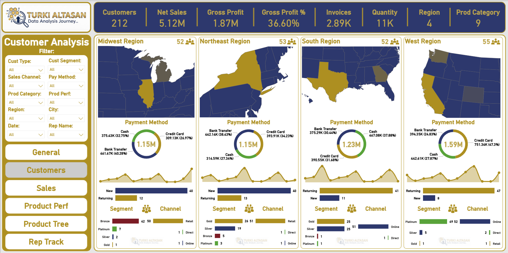
  </a>

  <a href="https://github.com/TurkiAltassan/TurkiAltassan/blob/main/For-sales-12.png">
    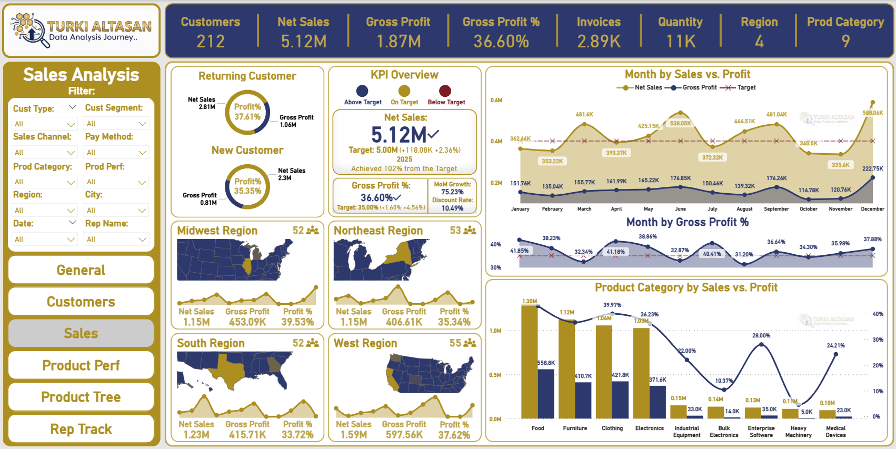
  </a>

  <a href="https://github.com/TurkiAltassan/TurkiAltassan/blob/main/For-sales-17.png">
    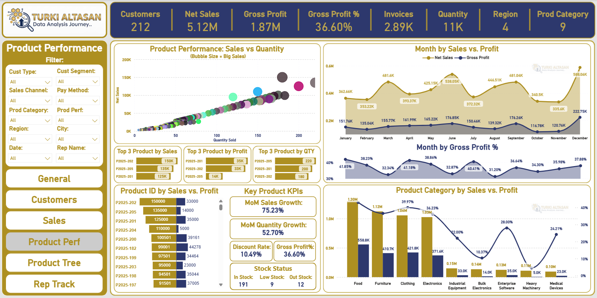
  </a>

  <a href="https://github.com/TurkiAltassan/TurkiAltassan/blob/main/For-sales-16.png">
    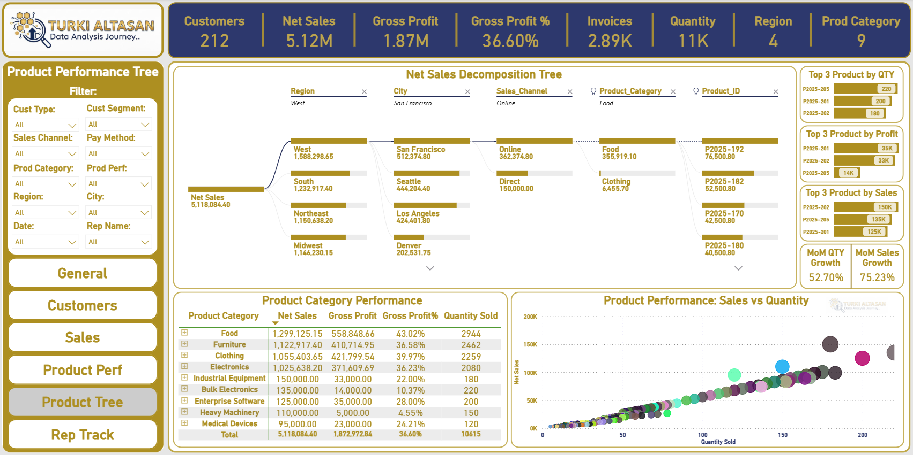
  </a>

  <a href="https://github.com/TurkiAltassan/TurkiAltassan/blob/main/For-sales-15.png">
    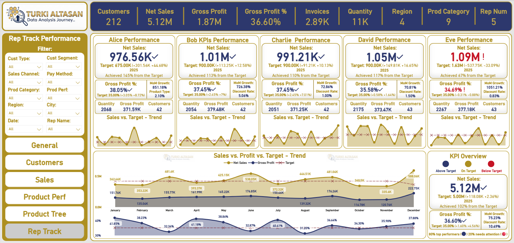
  </a>

[Back to featured project](#featured-project)

---

## More selected work

**Explore a business question, then open the project to see the approach and report previews.**

| Project | Business question | Tools |
| :--- | :--- | :--- |
| [Sales & Performance](#sales-performance) | Are sales, profitability, and target achievement moving together? | Excel · Power BI |
| [Sales, Customers & POS](#sales-pos) | Which products, branches, and customer groups drive performance? | Excel · Power BI |
| [E-commerce Customer Analysis](#ecommerce) | Who are our customers, and what shapes their purchasing behavior? | SQL · BigQuery · Power BI |
| [Tharwa Bank · Customer Churn](#tharwa-bank) | Which customer patterns can inform retention priorities? | SQL · BigQuery · Looker Studio |
| [Voice Verification](#voice-verification) | How can voice patterns be used to verify a user? | Python · tkinter |

<strong>01 · Comprehensive Sales & Performance Dashboard</strong> — 8 dashboard pages

 

**Objective:** Analyze sales performance, customer behavior, and sales representative targets using a Kaggle dataset.

**Approach:** Built eight interactive dashboard pages connecting sales, profitability, products, regions, customers, and representatives. Time-series analysis, geographic comparisons, and a decomposition tree help users investigate performance.

| Net Sales | Target Achievement | Profit | Profit Margin | Customers |
| :---: | :---: | :---: | :---: | :---: |
| **5.00M SAR** | **104.27%** | **252K SAR** | **5.05%** | **2.84K** |

**Decision supported:** Compare target achievement with profitability and investigate which regions, products, and customer segments contribute to the result.

**Tools:** Excel · Power BI

  <a href="https://github.com/TurkiAltassan/TurkiAltassan/blob/main/For-sales-4.png">
    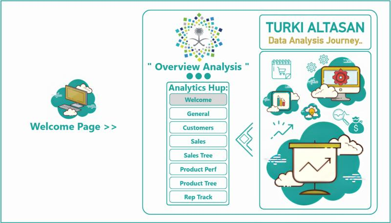
  </a>

  <a href="https://github.com/TurkiAltassan/TurkiAltassan/blob/main/For-sales-5.png">
    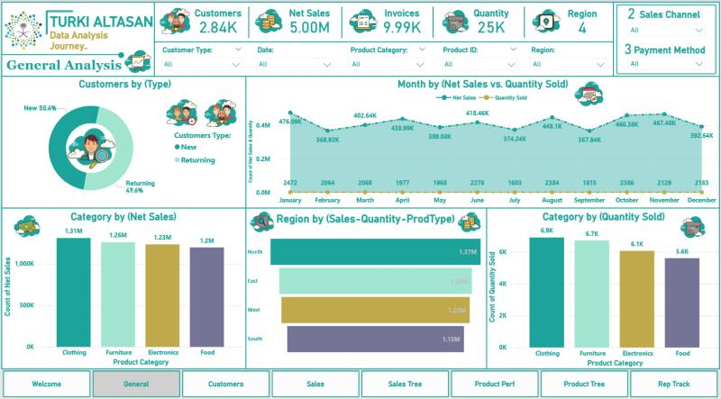
  </a>

  <a href="https://github.com/TurkiAltassan/TurkiAltassan/blob/main/For-sales-6.png">
    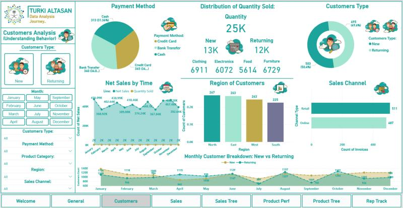
  </a>

  <a href="https://github.com/TurkiAltassan/TurkiAltassan/blob/main/For-sales-7.png">
    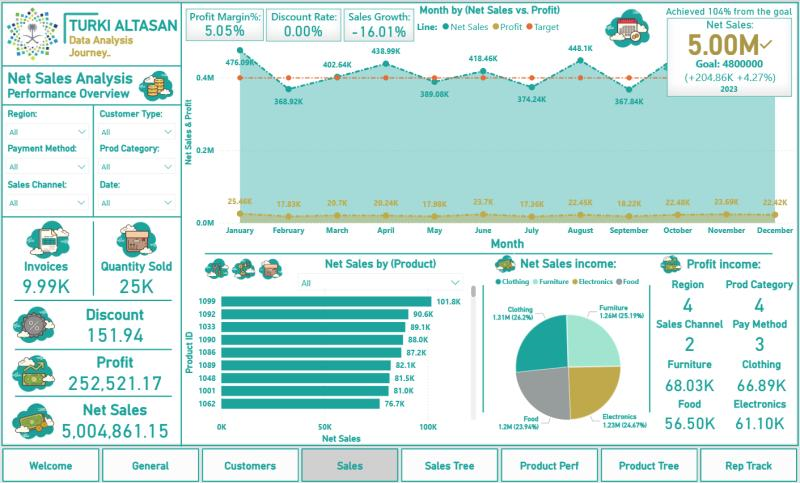
  </a>

  <a href="https://github.com/TurkiAltassan/TurkiAltassan/blob/main/For-sales-8.png">
    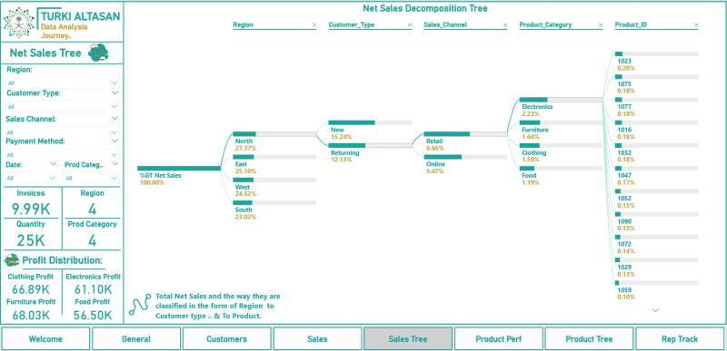
  </a>

  <a href="https://github.com/TurkiAltassan/TurkiAltassan/blob/main/For-sales-9.png">
    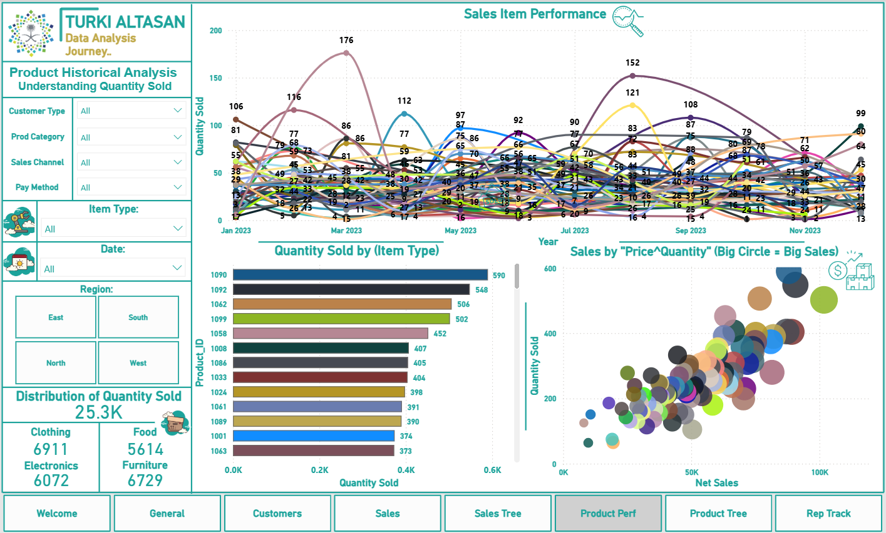
  </a>

  <a href="https://github.com/TurkiAltassan/TurkiAltassan/blob/main/For-sales-10.png">
    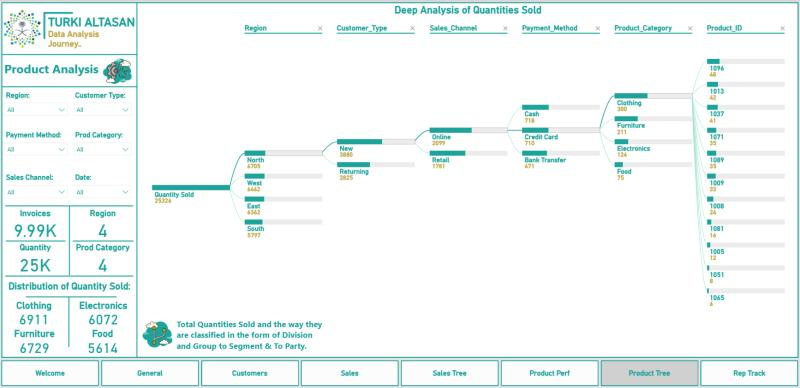
  </a>

  <a href="https://github.com/TurkiAltassan/TurkiAltassan/blob/main/For-sales-11.png">
    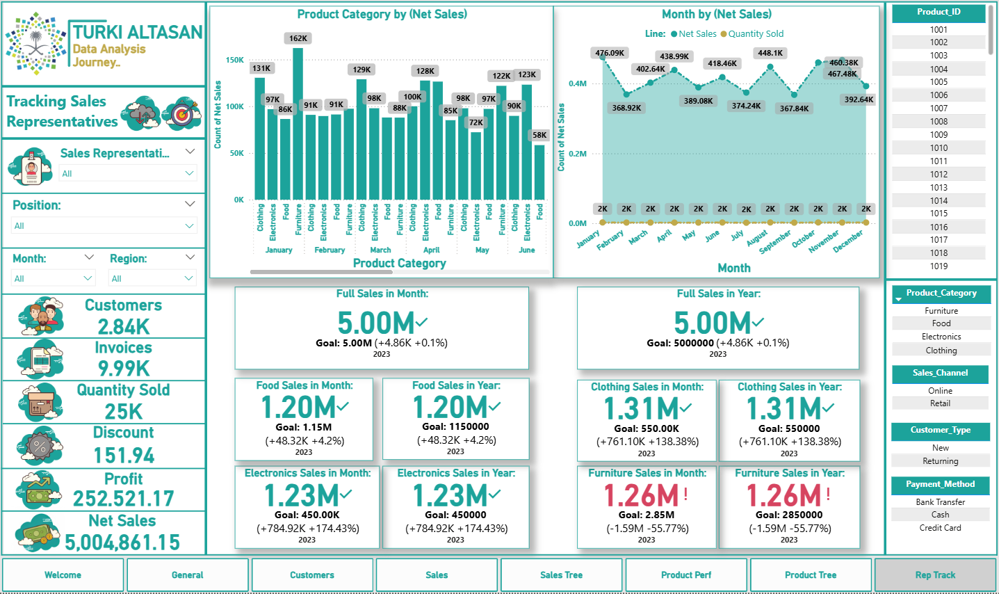
  </a>

[Back to project index](#more-projects)

<strong>02 · Sales, Customers & Point of Sale Performance</strong> — retail analysis

 

**Objective:** Explore sales and customer behavior using a Kaggle dataset, with a focus on branch and point of sale performance.

**Analysis:** Customer purchasing behavior and geography, product line sales and profitability, payment methods, and branch financial performance.

**Decision supported:** Review product priorities, membership opportunities, and differences in branch performance.

**Tools:** Excel · Power BI

  <a href="https://github.com/TurkiAltassan/TurkiAltassan/blob/main/For-sales-1.png">
    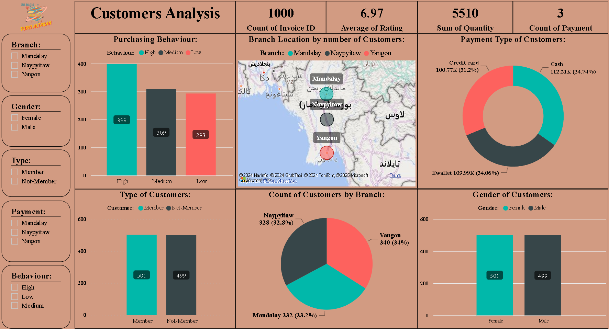
  </a>

  <a href="https://github.com/TurkiAltassan/TurkiAltassan/blob/main/For-sales-2.png">
    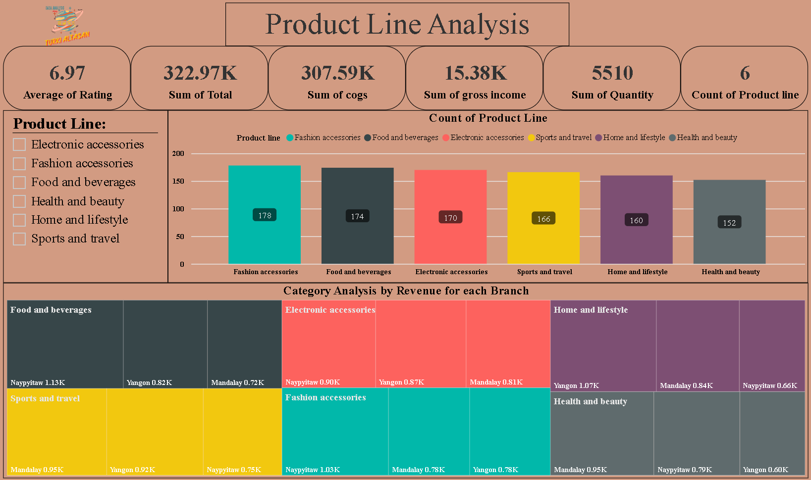
  </a>

  <a href="https://github.com/TurkiAltassan/TurkiAltassan/blob/main/For-sales-3.png">
    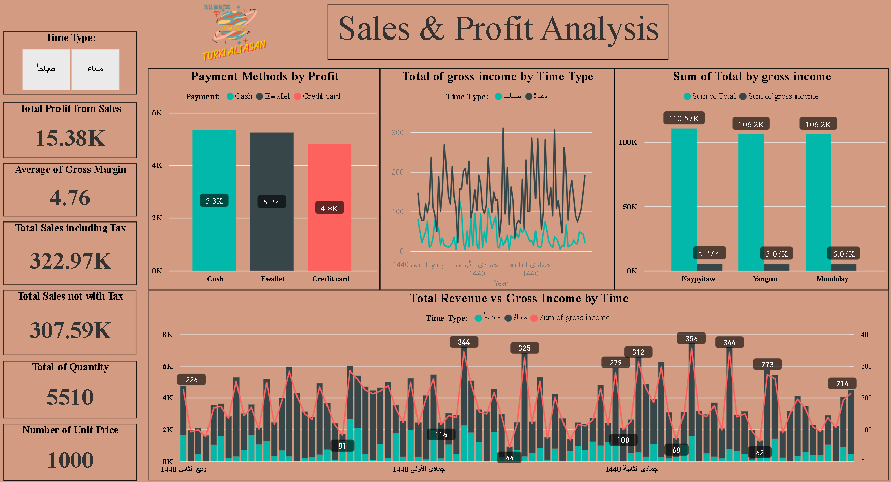
  </a>

[Back to project index](#more-projects)

<strong>03 · E-commerce Customer Performance Analysis</strong> — SQL to dashboard

 

**Objective:** Understand customer demographics, purchasing behavior, sales distribution, and product performance for an online store.

**Approach:** Used SQL in Google BigQuery to clean, organize, and analyze the data, then built a Power BI dashboard to communicate the findings.

**Analysis:** Category and brand sales, customer locations, age and gender distribution, customer acquisition sources, and purchasing behavior.

**Decision supported:** Inform audience targeting and product priorities using customer and sales patterns.

**Tools:** SQL · Google BigQuery · Power BI

  

[Back to project index](#more-projects)

<strong>04 · Tharwa Bank · Customer Churn Analysis</strong> — retention insights

 

**Objective:** Understand customer attrition and identify patterns that can inform retention strategies.

**Approach:** Explored customer activity and transactions, cleaned and transformed data with SQL and BigQuery, and visualized churn and engagement metrics in Looker Studio.

**Analysis:** Customer segments, engagement, transaction behavior, account activity, and patterns associated with churn.

**Decision supported:** Prioritize customer segments for retention review and monitor indicators associated with attrition.

**Tools:** SQL · Google BigQuery · Looker Studio

The project focuses on analysis and recommendations; no measured reduction in churn is claimed.

  <a href="https://github.com/TurkiAltassan/TurkiAltassan/blob/main/pic1.png">
    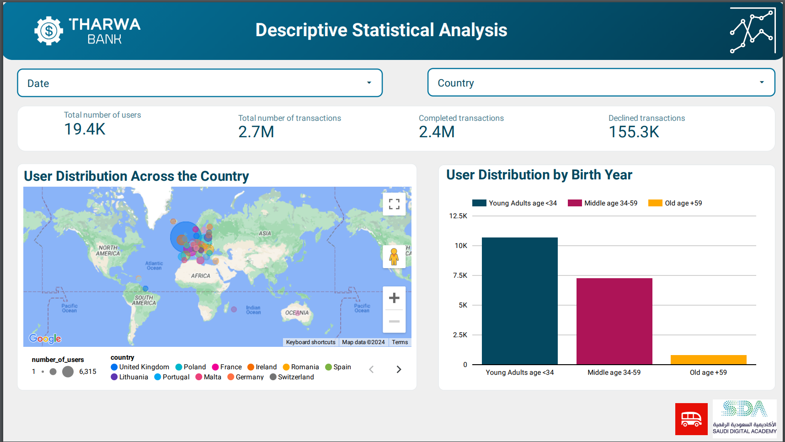
  </a>

  <a href="https://github.com/TurkiAltassan/TurkiAltassan/blob/main/pic2.png">
    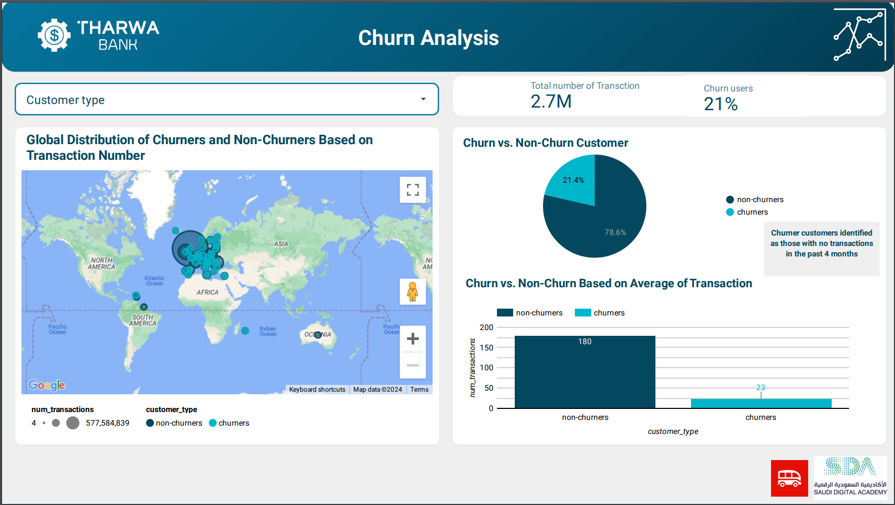
  </a>

  <a href="https://github.com/TurkiAltassan/TurkiAltassan/blob/main/pic3.png">
    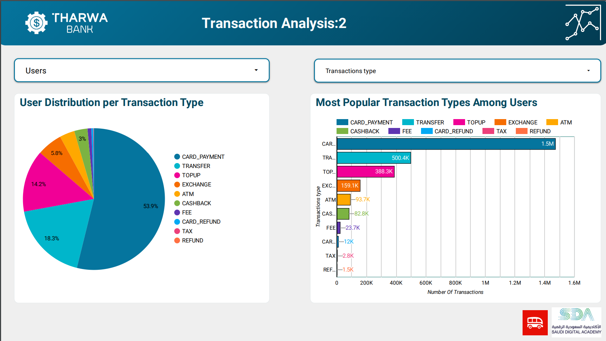
  </a>

[Back to project index](#more-projects)

<strong>05 · Voice Verification · Computer Science Graduation Project</strong> — Python application

 

**Objective:** Explore user verification based on voice characteristics and differences in sound wave patterns.

**Implementation:** Developed a Python application with a tkinter graphical user interface.

**Tools:** Python · tkinter

  

  <a href="https://github.com/TurkiAltassan/TurkiAltassan/blob/main/pixelcut-export-m.jpeg">
    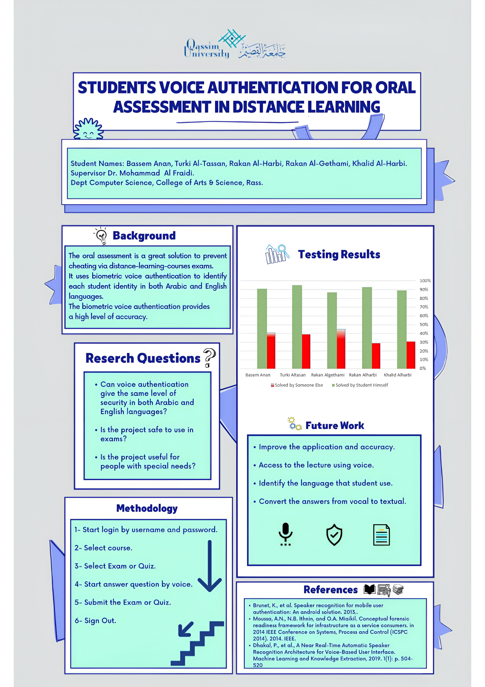
  </a>

  

[Back to project index](#more-projects)

---

## My analytical toolkit

  
  
  
  
  
  

| Area | Tools & techniques |
| :--- | :--- |
| Business intelligence | Power BI · DAX · Power Query · Data modeling · Row-level security |
| Data preparation & querying | SQL · Google BigQuery · Excel · Data cleaning & validation |
| Python analysis | Pandas · NumPy · Matplotlib |
| Reporting & exploration | Tableau · Looker Studio · KPI design · Trend & profitability analysis |

<strong>How I approach an analytical problem</strong>

 

1. **Start with the decision.** Clarify who will use the analysis and what action it should inform.
2. **Validate the data.** Check completeness, consistency, and the definitions behind the numbers.
3. **Build the model.** Connect the relevant datasets and define measures that reflect business logic.
4. **Design for exploration.** Give users an overview and a clear path into the detail.
5. **Translate the findings.** Explain the gaps, opportunities, and next questions in business terms.

---

## Education & credentials

| Credential | Institution / provider |
| :--- | :--- |
| **Microsoft Certified: Power BI Data Analyst Associate** | Microsoft |
| **Google Advanced Data Analytics Professional Certificate** | Google · Coursera |
| **CompTIA Data+** | CompTIA |
| **Bachelor's Degree in Computer Science** | Academic degree |
| **Data Analysis Bootcamp · May 2024** | Saudi Digital Academy · Le Wagon |
| **Data Science & Artificial Intelligence Track** | Satr Educational Platform · Tuwaiq Academy |
| **Specialist · Computer Science** | Saudi Council of Engineers |

---

<h3>Let's turn your next business question into a clear answer.</h3>

Based in Riyadh and open to analytics opportunities, collaboration, and conversations about better business decisions through data.

<a href="https://www.linkedin.com/in/turki-altasan/">LinkedIn</a> · <a href="mailto:altassanturki@gmail.com">Email</a> · <a href="https://wa.me/966554763478">WhatsApp</a>

<a href="#top">↑ Back to top</a>

